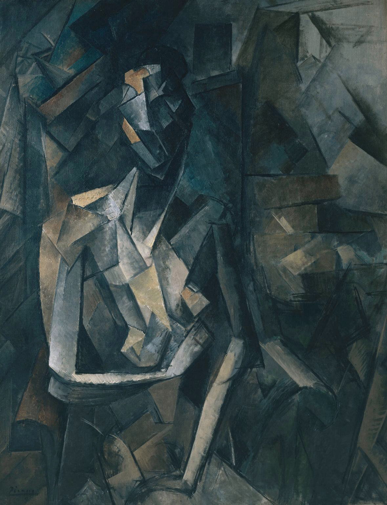
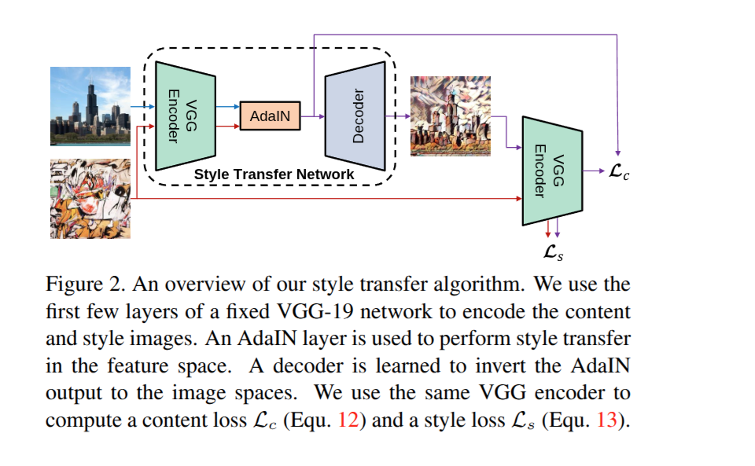

<div align="center">

# 🎨 StyleForge AI · Neural Style Transfer
### *Bridging Human Creativity & Deep Learning with Real-Time Arbitrary Style Transfer*

[](https://pytorch.org/)
[](https://flask.palletsprojects.com/)
[](https://pytorch.org/vision/stable/index.html)
[](LICENSE)
[](https://developer.nvidia.com/cuda-zone)

<p align="center">
  <em>"Every artist dips his brush in his own soul, and paints his own nature into his pictures."</em><br>
  <strong>— Henry Ward Beecher</strong>
</p>

[Overview](#-about-the-project) •
[Visual Showcase](#-visual-showcase) •
[How AdaIN Works](#-how-it-works-under-the-hood) •
[Quick Start](#-quick-start-guide) •
[Model Weights](#-model-weights--checkpoints) •
[Web Interface](#-web-application) •
[Training Guide](#-training-your-own-decoder) •
[Project Structure](#-project-structure)

</div>

---

## 🌸 Welcome to StyleForge AI

Welcome! **StyleForge AI** is an open-source deep learning project that brings the timeless beauty of fine art to any photograph in real-time. 

Traditional neural style transfer methods often require hundreds of optimization iterations for every single image, taking minutes or even hours. Single-style feed-forward networks solved the speed problem, but locked the model to one specific artistic style per training cycle.

This repository implements **Arbitrary Style Transfer in Real-time with Adaptive Instance Normalization (AdaIN)**, based on the research by *Xun Huang and Serge Belongie (ICCV 2017)*. With AdaIN:
- ✨ **Any Content Image** can be stylized with **Any Artistic Painting**.
- ⚡ **Zero optimization at test time**: Stylization happens in a single forward pass (milliseconds on GPU).
- 🎛️ **Continuous Style Control**: Dynamically adjust the artistic intensity using an interactive slider ($\alpha \in [0.0, 1.0]$).
- 🌐 **Modern Web Application**: Complete with an ambient cyber-glassmorphic UI built using Flask and Bootstrap 5.

---

## 🖼️ Visual Showcase

Here is a glimpse of what StyleForge AI creates. In each example, content geometry is preserved while textures, color palettes, and brushstrokes from the style image are transferred naturally:

### Example 1: Pencil Sketching on Portrait
| Content Photo | Style Reference | Stylized Result |
| :---: | :---: | :---: |
|  |  |  |
| *Original Portrait* | *Pencil Sketch Art* | *Generated Sketch Portrait* |

### Example 2: Cubist Painting (Picasso) on Portrait
| Content Photo | Style Reference | Stylized Result |
| :---: | :---: | :---: |
|  |  |  |
| *Original Portrait* | *Pablo Picasso — Seated Nude* | *Generated Cubist Portrait* |

---

## 🧠 How It Works Under the Hood

The architecture consists of three primary building blocks:

```
                  ┌──────────────────────┐
Content Image ───►│  Fixed VGG-19 Enc    ├────► f(c) ──┐
                  └──────────────────────┘             ▼
                                                ┌─────────────┐
                                                │ AdaIN Layer │──► t ──►┌─────────────┐
                                                └─────────────┘         │  Trained    ├──► Stylized Image
                                                       ▲                │  Decoder    │
                  ┌──────────────────────┐             │                └─────────────┘
Style Image   ───►│  Fixed VGG-19 Enc    ├────► f(s) ──┘
                  └──────────────────────┘
```

1. **VGG-19 Encoder (Frozen)**:
   A normalized VGG-19 backbone truncated at `relu4_1`. It extracts rich semantic representations of the content image $f(c)$ and multi-scale texture features of the style image $f(s)$.

2. **Adaptive Instance Normalization (AdaIN)**:
   Unlike standard Batch Normalization or Instance Normalization that normalize using learnable parameters, **AdaIN has no learnable affine parameters**. Instead, it normalizes the content features to zero mean and unit variance, and directly shifts and scales them by the mean and standard deviation of the style features:

   $$\text{AdaIN}(x, y) = \sigma(y) \left( \frac{x - \mu(x)}{\sigma(x)} \right) + \mu(y)$$

   where $\mu$ and $\sigma$ denote channel-wise spatial mean and standard deviation.

3. **Invertible Decoder (Trained)**:
   A lightweight convolutional network mirroring the encoder. The decoder is trained to invert the stylized feature representations back into crisp RGB images.

4. **Adjustable Style Strength ($\alpha$)**:
   You can smoothly interpolate between the original content and full artistic style by blending feature vectors before feeding them to the decoder:

   $$t = \alpha \cdot \text{AdaIN}(f(c), f(s)) + (1 - \alpha) f(c)$$

   - $\alpha = 0.0$: Preserves the original content image.
   - $\alpha = 0.5$: Subtle, gentle painterly wash.
   - $\alpha = 1.0$: Full artistic stylization.

### Algorithm Flowchart
The diagram below illustrates the exact feature transformation during inference:

<div align="center">
  
</div>

---

## 📁 Project Structure

```text
NST_DL_Project/
├── app.py                      # Flask web application & inference engine
├── train.py                    # Training pipeline for the custom decoder
├── requirements.txt            # Python dependencies
├── Procfile                    # Deployment entry point for PaaS platforms
├── adain_algo.png              # Architecture and algorithm flow diagram
├── download_commons_styles.ps1 # Script to download CC0/Public Domain styles
├── code.ipynb                  # Experimental analysis & exploratory notebook
│
├── utils/
│   ├── models.py               # VGGEncoder & Decoder PyTorch network definitions
│   └── utils.py                # AdaIN logic, mean/variance calculation, datasets
│
├── templates/
│   └── index.html              # Modern dark-mode web interface with live previews
│
├── static/
│   └── uploads/                # Directory for user-uploaded session images
│
├── examples/                   # High-res sample inputs and stylized outputs
├── Demo_IO_Images/             # Additional demo input/output comparisons
├── content_data/               # Curated content images for testing
└── style_data/                 # Curated artistic style images (Impressionism, etc.)
```

---

## 📦 Model Weights & Checkpoints

To run inference or launch the web application, two weight files are involved:

| Weight File | Location | Typical Size | Description |
| :--- | :--- | :--- | :--- |
| **`vgg_normalised.pth`** | Project root (`./vgg_normalised.pth`) | ~80 MB | Pre-trained normalized VGG-19 encoder up to `relu5_1`. |
| **`decoder_final.pth`** | `experiment/final_exp/decoder_final.pth` | ~14 MB | Trained AdaIN decoder checkpoint. |

> [!TIP]
> **Ready Out of the Box!**  
> For maximum convenience, both **`vgg_normalised.pth`** (~76 MB) and **`decoder_final.pth`** (~14 MB) are already included directly in this repository. You can clone the repo and immediately start generating artwork without needing to search for or download external weight files.

---

## 🚀 Quick Start Guide

### 1. Clone the Repository
```bash
git clone https://github.com/NehanPathan/NeuralArt-StyleForgeAI.git
cd NeuralArt-StyleForgeAI
```

### 2. Create and Activate a Virtual Environment
Using `venv` (recommended):
```bash
# On Windows (PowerShell):
python -m venv venv
.\venv\Scripts\Activate.ps1

# On macOS / Linux:
python3 -m venv venv
source venv/bin/activate
```

Or using Conda:
```bash
conda create -n nst_env python=3.10 -y
conda activate nst_env
```

### 3. Install Dependencies
```bash
pip install -r requirements.txt
```

### 4. Verify Model Weights Placement
Ensure `vgg_normalised.pth` is in the project root and `decoder_final.pth` is inside `experiment/final_exp/`.

---

## 🌐 Web Application

StyleForge AI comes with a sleek, interactive web interface featuring:
- **Instant Drag & Drop / File Selection** with live thumbnail previews.
- **Real-Time Style Strength Slider** ($\alpha$ slider from 0.0 to 1.0).
- **Direct Download** of the resulting stylized artwork.
- **Embedded Examples & FAQ Section** to guide new users.

### Launching the Web Server:
```bash
python app.py
```

Once started, open your favorite browser and visit:
```text
http://127.0.0.1:5000/
```

> [!TIP]
> The application will automatically detect CUDA if a compatible NVIDIA GPU is present; otherwise, it will gracefully fall back to CPU inference.

---

## 🏋️ Training Your Own Decoder

If you would like to train the decoder on your own custom collection of photos and artwork, you can use `train.py`:

```bash
python train.py \
  --content_dir ./content_data/train_3 \
  --style_dir ./style_data \
  --vgg ./vgg_normalised.pth \
  --experiment my_custom_experiment \
  --batch_size 8 \
  --epochs 100 \
  --lr 1e-4 \
  --content_weight 1.0 \
  --style_weight 5.0
```

### Key Training Options:
| Parameter | Default | Purpose |
| :--- | :---: | :--- |
| `--content_dir` | Required | Path to the directory containing content training images (e.g., COCO). |
| `--style_dir` | Required | Path to the directory containing style training images (e.g., WikiArt). |
| `--vgg` | `vgg_normalised.pth` | Path to the fixed VGG encoder weights. |
| `--content_weight`| `1.0` | Weight assigned to Euclidean content loss $\mathcal{L}_c$. |
| `--style_weight` | `5.0` | Weight assigned to moment-matching style loss $\mathcal{L}_s$. |
| `--batch_size` | `4` | Number of image pairs per training step. |
| `--epochs` | `1` | Number of full passes over the content loader. |
| `--lr` | `1e-4` | Learning rate (Adam optimizer). |
| `--lr_decay` | `5e-5` | Learning rate decay per step. |
| `--crop` | `True` | Randomly crops images to uniform size for stable mini-batch training. |

Training checkpoints, intermediate generated sample grids (`sample_iter_*.png`), and run arguments are automatically saved in `experiment/<experiment_name>/`.

---

## 🏛️ Ethically Sourcing Style Data

Interested in expanding your collection of painting styles?  
We include a PowerShell utility script, `download_commons_styles.ps1`, which queries the **Wikimedia Commons API** to curate high-resolution public-domain and Creative Commons (CC0) historical artworks.

To run the collector:
```powershell
powershell -ExecutionPolicy Bypass -File .\download_commons_styles.ps1
```
The script downloads curated paintings directly into `style_data/` and generates an attribution manifest (`commons_sources.csv`) documenting artist names, public-domain license tags, and source URLs.

---

## 💡 Tips & Best Practices

1. **Choosing the Right Style Image**:
   - Artworks with pronounced textures, bold brushstrokes, and distinctive palettes (e.g., Van Gogh, Monet, Picasso, Kandinsky) produce the most visually stunning transfers.
   - For gentle, portrait-safe edits, pencil sketches or minimalist line art work wonderfully.
2. **Tuning Style Strength ($\alpha$)**:
   - $\alpha \approx 0.7 - 0.9$ is often the "sweet spot" for balancing recognizable facial features with rich painterly textures.
3. **Resolution**:
   - The web app processes images resized to 512px on the short edge, which balances high visual detail with sub-second inference speeds.

---

## 🤝 Contributing & Community

Contributions, suggestions, and creative experiments are warmly welcomed!  
If you have an idea for an enhancement:
1. Fork this repository.
2. Create a feature branch: `git checkout -b feature/amazing-feature`.
3. Commit your changes: `git commit -m "Add amazing feature"`.
4. Push to your branch: `git push origin feature/amazing-feature`.
5. Open a friendly Pull Request!

If you encounter any questions or issues, please feel free to open an **Issue** or reach out.

---

## 📜 References & Acknowledgments

- **Huang, Xun, and Serge Belongie.** *"Arbitrary style transfer in real-time with adaptive instance normalization."* Proceedings of the IEEE International Conference on Computer Vision (ICCV), 2017.
- **Gatys, Leon A., Alexander S. Ecker, and Matthias Bethge.** *"Image style transfer using convolutional neural networks."* Proceedings of the IEEE Conference on Computer Vision and Pattern Recognition (CVPR), 2016.
- Pre-trained network backbones powered by the PyTorch and Torchvision teams.
- Wikimedia Commons community for preserving and digitizing public-domain cultural heritage.

---

<div align="center">
  <p>Crafted with curiosity, care, and a passion for deep learning & art. ✨</p>
  <p>⭐ If you found this repository helpful or inspiring, please consider giving it a star on GitHub!</p>
</div>